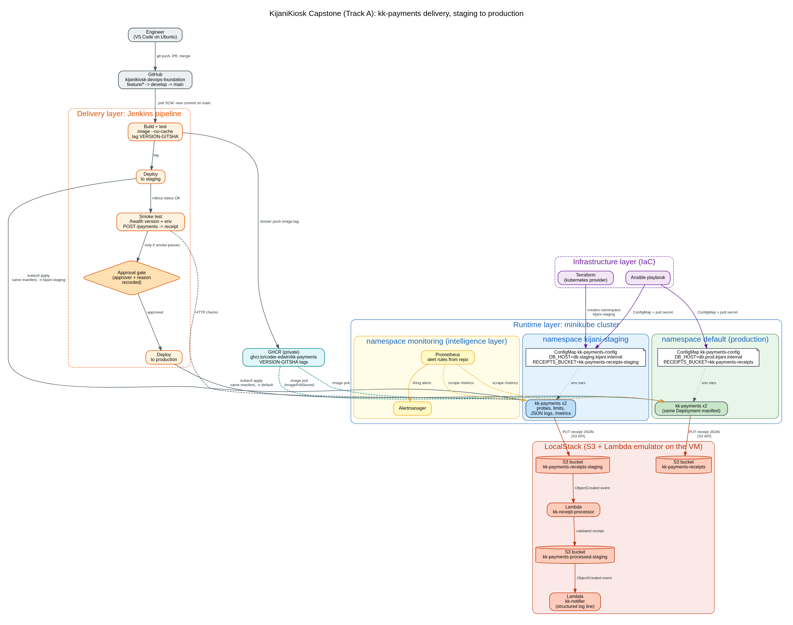

# KijaniKiosk Capstone: kk-payments from commit to production

**Track A (Infrastructure-First).** Every change to kk-payments now goes through the same path: merge to `main` → Jenkins builds and unit-tests the image → pushes it to GHCR with a `VERSION-GITSHA` tag → deploys it to a **staging** namespace built by Terraform and configured by Ansible → smoke-tests it, including a real payment and the receipt chain → waits for a **recorded human approval** → deploys the *same image* to **production**. Prometheus watches both environments and alerts when receipts stop being stored.

> Goal set by Nia: *a new engineer can clone this repository and contribute meaningfully within a day.* This README is written for that engineer.

---

## 1. Architecture



| Layer | What it is | Where it lives |
|---|---|---|
| Infrastructure | Terraform creates `kijani-staging` (ResourceQuota + LimitRange); Ansible gives each environment its `kk-payments-config` ConfigMap and the GHCR pull secret | `infra/terraform`, `infra/ansible` |
| Delivery | Jenkins: build + unit test → push → converge config → deploy staging → smoke test → **approval gate** → deploy production | `Jenkinsfile`, `jenkins/` |
| Runtime | kk-payments (TypeScript, Node 20 on Alpine, non-root, read-only filesystem). One Deployment manifest for both environments, with probes, limits, JSON logs and `/metrics` | `app/`, `k8s/` |
| Intelligence | Prometheus + Alertmanager with alert rules in the repo; receipt chain (`kk-receipt-processor` → `kk-notifier`) on LocalStack | `monitoring/`, `serverless/` |

Scope, success criteria (S1–S6) and the decisions behind them: [`docs/scope.md`](docs/scope.md).

## 2. Repository layout

```
capstone/
├── Jenkinsfile                 # the delivery pipeline
├── app/                        # kk-payments service, unit tests, Dockerfile.production
├── k8s/                        # deployment.yaml + service.yaml (shared by both environments)
├── infra/terraform/            # kijani-staging namespace, quota, limit range
├── infra/ansible/              # per-environment ConfigMaps + pull secret (vars/staging.yml, vars/production.yml)
├── monitoring/                 # prometheus.yml, alert-rules.yml, alertmanager.yml, monitoring.yaml
├── serverless/                 # receipt chain Lambdas + deploy-chain.sh (runs inside LocalStack)
├── jenkins/job-config.xml      # Jenkins job definition
├── scripts/                    # bootstrap, deploy, smoke test, setup and demo helpers
└── docs/                       # scope, architecture, governance log, test plan, feedback log, evidence
```

## 3. Prerequisites

On one Ubuntu machine (tested on Ubuntu 24.04 in VMware, 4 vCPU, 8–12 GB RAM, 60 GB disk):

| Tool | Version used | Check |
|---|---|---|
| Docker Engine | 27+ | `docker ps` works **without sudo** |
| minikube (docker driver) | 1.39 | `minikube status` |
| kubectl | matches cluster | `kubectl get nodes` |
| Terraform | ≥ 1.5 (used 1.16) | `terraform -version` |
| Ansible core | ≥ 2.14 (used 2.16) | `ansible --version` |
| Jenkins (system service) + Java 21 | LTS | `systemctl status jenkins` |
| A GitHub personal access token (classic) with `write:packages` | n/a | `docker login ghcr.io` succeeds |

## 4. Setup from a clean checkout

Run from the repository root. Every script is idempotent, so re-running is safe.

```bash
# 0. Cluster and registry login (once)
minikube start --driver=docker
docker login ghcr.io -u <github-user>            # token is typed, never stored in the repo
kubectl create secret docker-registry kijani-registry-credentials \
  --docker-server=ghcr.io --docker-username=<github-user> --docker-password=<token>   # production namespace; skip if it exists

# 1. Infrastructure layer (S1): staging namespace + config for both environments
bash capstone/scripts/bootstrap-infra.sh         # prints "converged in Ns"

# 2. Receipt chain on LocalStack
bash capstone/scripts/setup-localstack.sh

# 3. Monitoring
bash capstone/scripts/setup-monitoring.sh        # Prometheus :30090, Alertmanager :30093 on the minikube IP

# 4. Jenkins
bash capstone/scripts/setup-jenkins.sh           # gives the jenkins user docker + a minikube kubeconfig
#    In the Jenkins UI: Manage Jenkins → Credentials → add "Username with password",
#    ID = ghcr, username = <github-user>, password = <token>
JENKINS_USER=<you> JENKINS_TOKEN=<api-token> bash capstone/scripts/create-jenkins-job.sh
```

## 5. Delivering a change

1. Branch from `develop`: `git checkout -b feature/<what>`. Use [conventional commits](https://www.conventionalcommits.org/) (`feat(app): …`, `fix(infra): …`).
2. Open a PR into `develop`. Record any AI assistance in [`docs/ai-governance-log.md`](docs/ai-governance-log.md) *before* merging.
3. Release: open a PR `develop → main` and merge it. Jenkins polls `main` every 2 minutes and starts the pipeline on its own.
4. Watch **kijanikiosk-capstone** in Jenkins. When staging passes its smoke test, the build pauses at **Production approval**. Enter a reason, which is required and stored in `approval-record.txt` with your username, then approve.
5. The pipeline deploys the identical image to production and runs a health smoke test there.

**Rollback:** `deploy.sh` rolls back automatically if a rollout does not become healthy. To roll back a healthy-but-wrong release: `kubectl rollout undo deployment/kk-payments -n default`.

## 6. Testing and the demo

| What | How |
|---|---|
| Unit tests | Run inside the image build (`npm test`), so a failing test fails the pipeline before anything is pushed |
| Smoke test | `bash capstone/scripts/smoke-test.sh kijani-staging <tag> full`: version, environment, DB_HOST, readiness, metrics, a real payment, receipt stored, chain fired |
| Receipt chain (S5) | `bash capstone/scripts/show-receipt-chain.sh` |
| **Fault demo (S4 + S6)** | `docker stop kijani-localstack` → run `bash capstone/scripts/payment-traffic.sh kijani-staging` → payments return 503, logs show `receipt write failed`, **KkPaymentsReceiptWriteErrors** fires in Prometheus within ~2 min; a pipeline run now stops at *Smoke test staging* and production is untouched. `docker start kijani-localstack` resolves it. |

The full test plan, written before the peer review, is in [`docs/test-plan.md`](docs/test-plan.md). Peer review findings are in [`docs/feedback-log.md`](docs/feedback-log.md).

## 7. Troubleshooting and known gaps

| Symptom | Cause and fix |
|---|---|
| Pods in `ImagePullBackOff` in staging | Pull secret missing or stale: re-run `bootstrap-infra.sh` (Ansible copies it from production) |
| Smoke test fails at "receipt stored" | LocalStack is down: `docker start kijani-localstack`, then `bash capstone/scripts/setup-localstack.sh` |
| Jenkins `permission denied` on docker | `setup-jenkins.sh` was not run, or Jenkins was not restarted after it |
| Jenkins cannot reach the cluster | minikube restarted with a new certificate: re-run `setup-jenkins.sh` to refresh `/var/lib/jenkins/.kube/config` |
| `ansible.cfg` ignored | Ansible ignores config in world-writable directories; run from a normal checkout |

**Known production gaps** (deliberately out of scope; see the scope document):
- Single-node minikube, so there is no node-level high availability.
- No NetworkPolicy, so staging and production are separated by name and quota only, not by network.
- LocalStack instead of real AWS; real AWS would use IAM roles for the Pods instead of LocalStack's placeholder credentials.
- Terraform state is local to the engineer's machine; a team would use a remote backend with locking.
- Alerts are visible in Alertmanager but not routed to Slack or email.
